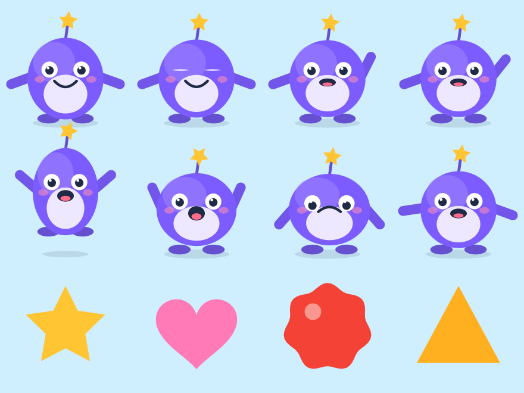

# نجوم (Nujoom)

تطبيق تعليمي أصلي للأطفال، مبني للتعلّم: كيف تُبنى تطبيقات الألعاب التعليمية من الداخل.

<p align="center"></p>

<p align="center"><sub>معاينة للشخصية "نور" والأشكال، مرسومة من معادلات الرسم نفسها الموجودة في الكود (ليست لقطة شاشة من التطبيق).</sub></p>

المشروع يسير على مرحلتين:

| المجلد | الحالة | الوصف |
|---|---|---|
| `flutter_app/` | **النسخة الحالية** | التطبيق كاملًا بـ Flutter |
| [`unity_app/`](unity_app/README.md) | **مكتوبة، لم تُجرَّب في المحرر بعد** | نفس التطبيق بـ Unity، مع تمارين لتعلّم المحرك |

النسختان تستخدمان الصيغة نفسها لملف المحتوى (`catalog.json`) والمؤثرات الصوتية نفسها.

> كل ما في هذا المستودع أصلي: الكود، الشخصية، الرسومات، الأصوات، والمحتوى. لا يحتوي أي كود أو أصول من تطبيقات أخرى. الأفكار المعمارية التي استفدنا منها موثّقة في [`docs/ARCHITECTURE_NOTES.md`](docs/ARCHITECTURE_NOTES.md).

## ماذا يفعل التطبيق

- شاشة رئيسية فيها الشخصية "نور" وخمسة عوالم: الحروف، الأرقام، الألوان، الحيوانات، الأشكال.
- ثلاثة قوالب ألعاب تعمل مع أي عالم: **أين هو؟** (اختيار)، **الذاكرة**، **التوصيل** (سحب وإفلات).
- تلميح للطفل المتردد: بعد 7 ثوانٍ بلا لمس تنبض الإجابة الصحيحة ويُعاد نطق الكلمة.
- نجوم لكل لعبة (من 1 إلى 3) تُحفظ على الجهاز.
- نطق الكلمات بمحرك النطق في الهاتف، ومؤثرات صوتية.
- عربي وإنجليزي، مع دعم الاتجاه من اليمين لليسار.
- منطقة للأهل خلف سؤال حسابي: اللغة، الصوت، تصفير التقدّم.

## التشغيل

تحتاج Flutter 3.32 أو أحدث.

```bash
cd flutter_app
flutter pub get
dart run tool/setup_platforms.dart   # مرة واحدة: ينشئ مجلدي android و ios
flutter run
```

سكربت `setup_platforms.dart` يشغّل `flutter create` ثم يضيف إعدادين يحتاجهما التطبيق على Android: إذن الوصول لمحرك النطق، والوضع الأفقي. بعد تشغيله أضف مجلدي `android/` و `ios/` إلى git.

### ملف APK جاهز من GitHub

كل رفع إلى المستودع يشغّل البناء التلقائي: من تبويب **Actions** افتح آخر تشغيل ونزّل `nujoom-apk` من قسم Artifacts.

## كيف تضيف درسًا جديدًا (بدون كود)

كل المحتوى في [`flutter_app/assets/content/catalog.json`](flutter_app/assets/content/catalog.json). لإضافة عالم جديد أضف عنصرًا إلى `topics`:

```json
{
  "id": "fruits",
  "title": { "ar": "الفواكه", "en": "Fruits" },
  "color": "#FF5A5F",
  "icon": { "kind": "emoji", "value": "🍓" },
  "items": [
    { "id": "apple",  "name": { "ar": "تفاحة", "en": "Apple" },  "visual": { "kind": "emoji", "value": "🍎" } },
    { "id": "banana", "name": { "ar": "موزة",  "en": "Banana" }, "visual": { "kind": "emoji", "value": "🍌" } },
    { "id": "grapes", "name": { "ar": "عنب",   "en": "Grapes" }, "visual": { "kind": "emoji", "value": "🍇" } }
  ],
  "activities": [
    { "id": "fruits_choice", "type": "choice", "rounds": 5 },
    { "id": "fruits_memory", "type": "memory" },
    { "id": "fruits_match",  "type": "match" }
  ]
}
```

أنواع الرسم المتاحة في `visual.kind`:

| النوع | `value` | مثال |
|---|---|---|
| `sprite` | اسم ملف صورة في `assets/art` بلا الامتداد | `"cat"` |
| `emoji` | رمز تعبيري | `"🐱"` |
| `glyph` | حرف أو رقم كبير | `{ "ar": "أ", "en": "A" }` |
| `color` | لون بصيغة hex | `"#F44336"` |
| `shape` | `circle` `square` `triangle` `star` `heart` | `"star"` |
| `dots` | عدد النقاط (1 إلى 9) | `"3"` |

الحقل الاختياري `pair` يحدد ما يُوصَّل به العنصر في لعبة التوصيل (حرف مع صورة، رقم مع نقاط). إن غاب يُستخدم الاسم المكتوب.

بعد التعديل شغّل `flutter test`: هناك اختبار يقرأ الملف ويتأكد أن كل لعبة فيه قابلة للتشغيل، ويسمّي الحقل الخاطئ إن وُجد.

## كيف نُظّم الكود

```
flutter_app/lib/
├── app/                 # التطبيق، التوجيه، حقن الاعتماديات، الألوان
├── core/
│   ├── mascot/          # الشخصية: رسمها وحركاتها
│   ├── motion/          # حركات جاهزة: ظهور، اهتزاز، نبض، قلب بطاقة، قصاصات
│   ├── audio/           # المؤثرات الصوتية والنطق
│   ├── widgets/         # أزرار وبطاقات ونجوم مشتركة
│   └── ...
└── features/
    ├── catalog/         # المحتوى: قراءة JSON، الشاشة الرئيسية، شاشة العالم
    ├── games/           # قواعد الألعاب، والقوالب الثلاثة، وشاشة النتيجة
    ├── progress/        # النجوم وحفظها
    └── settings/        # الإعدادات ومنطقة الأهل
```

كل ميزة مقسّمة إلى `domain` (قواعد بلغة Dart فقط)، `data` (قراءة وحفظ)، و `presentation` (واجهة و Cubit). الميزات لا تستورد شاشات بعضها: الربط بينها يحدث في `app/router/app_router.dart`.

### أين تبدأ القراءة

1. [`features/games/domain/game_engines.dart`](flutter_app/lib/features/games/domain/game_engines.dart): قواعد الألعاب الثلاث في ملف واحد بلا أي واجهة.
2. [`core/mascot/mascot.dart`](flutter_app/lib/core/mascot/mascot.dart): كيف تُرسم شخصية وتُحرَّك بالكود.
3. [`core/motion/motion.dart`](flutter_app/lib/core/motion/motion.dart): الحركات الجاهزة.
4. [`features/games/presentation/pages/game_page.dart`](flutter_app/lib/features/games/presentation/pages/game_page.dart): كيف تستضيف شاشة واحدة أي قالب لعبة.

## كيف تضيف قالب لعبة جديدًا

1. أضف القيمة إلى `GameType` في `features/catalog/domain/entities/catalog.dart`.
2. اكتب قواعد اللعبة كدوال صِرفة في `game_engines.dart` مع اختباراتها.
3. اكتب Cubit يصدر `GameFeedback` (صح، خطأ، انتهت).
4. اكتب واجهة القالب: تأخذ `ActivityBundle` ودالتين `onFeedback` و `onFinished`.
5. سجّله في `GamePage._buildTemplate`، وأضف اسمه وأيقونته في `topic_page.dart`.

الصوت وردّة فعل الشخصية وحفظ النجوم وشاشة النتيجة تعمل تلقائيًا، لأن `GamePage` هي التي تتولاها.

## كيف تستبدل الشخصية برسم احترافي

باقي التطبيق يعرف عن الشخصية شيئًا واحدًا: `MascotController.play(MascotMood)`. لاستبدال الرسم البرمجي بملف Rive أو Lottie غيّر ما بداخل `MascotView` فقط، واربط كل `MascotMood` بحركة في الملف.

الأمر نفسه للأصوات: استبدل ملفات `assets/audio/` بتسجيلات بنفس الأسماء. ولتسجيلات صوتية بدل النطق الآلي، اكتب تطبيقًا جديدًا للواجهة `Speaker`.

## ما تم التحقق منه

- **فحص ثابت** لكل الكود والاختبارات بمحلّل Dart مقابل Flutter 3.50: بلا أخطاء ولا تحذيرات.
- **42 اختبارًا** لقواعد الألعاب، قراءة المحتوى، وحفظ التقدّم: شُغّلت ونجحت.
- **اختبارات الرسم** (`test/widget_test.dart`) كُتبت وفُحصت ثابتًا، وتُشغَّل لأول مرة في البناء التلقائي على GitHub.

**لم يُشغَّل التطبيق بعد على هاتف أو محاكي.** التشغيل الأول قد يُظهر ملاحظات في المقاسات أو التوقيت تحتاج ضبطًا.

ملاحظة: على Flutter 3.47 وما بعده يظهر تنبيه بأن `package:flutter/material.dart` سينتقل إلى حزمة مستقلة. هذا تنبيه وليس خطأ، وأبقينا الاستيراد الحالي ليعمل المشروع على الإصدارات الأقدم أيضًا.

## الاختبار اليدوي

قائمة مرتبة بما تجرّبه في النسختين وما المتوقع في كل خطوة: [`docs/TEST_PLAN.md`](docs/TEST_PLAN.md).

## التراخيص

الخط المستخدم Baloo Bhaijaan 2 مرخّص برخصة SIL Open Font License، ونصّها في `flutter_app/assets/fonts/OFL.txt`.
