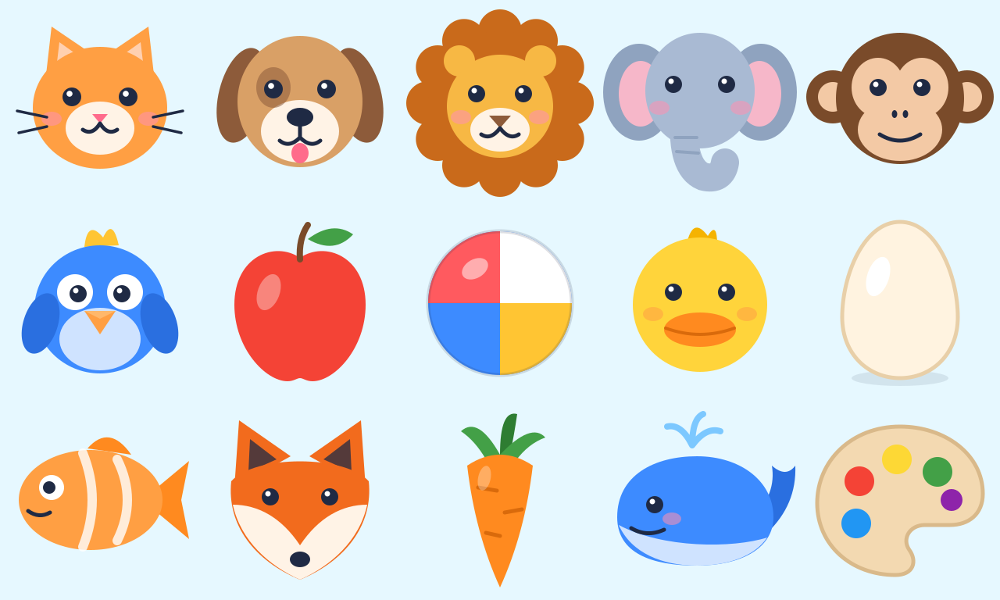

# نجوم (Unity)

نسخة Unity من تطبيق نجوم، مبنية للتعلّم. كل شيء فيها يُبنى بالكود وقت التشغيل: تضغط Play فيعمل التطبيق دون تركيب أي شيء يدويًا في المحرر. بعدها تنتقل إلى أدوات المحرر خطوة خطوة عبر التمارين في آخر هذا الملف.

<p align="center"></p>

> **حالة الفحص:** قواعد الألعاب، تشكيل النص العربي، وملف المحتوى شُغّلت واختُبرت فعليًا (1383 فحصًا ناجحًا). باقي السكربتات فُحصت نحويًا فقط مقابل تعريفات بديلة لـ Unity، و**لم تُفتح بعد في محرر Unity**. توقّع أخطاء في أول تشغيل، وأرسل لي ما يظهر في نافذة Console.

## التشغيل

تحتاج Unity Hub مع نسخة **2022.3 LTS** أو **Unity 6**.

1. في Unity Hub: **New project**، اختر قالب **2D (Built-in Render Pipeline)** أو **Universal 2D**، وأنشئه في أي مكان.
2. انسخ المجلد `unity_app/Assets/Nujoom` إلى مجلد `Assets` في المشروع الجديد.
3. انتظر حتى ينتهي Unity من الاستيراد، ثم اضغط **Play**.
4. في نافذة Game اختر نسبة العرض **16:9**.

لا تحتاج إلى فتح مشهد معيّن أو وضع أي كائن: التطبيق يشغّل نفسه من أي مشهد.

عند التشغيل داخل المحرر يظهر في Console سطر مثل `Nujoom self check: all 1383 checks passed`. يمكنك تشغيل الفحص يدويًا من القائمة **Nujoom > Run Self Check**.

### لإبقاء المشروع داخل هذا المستودع

بعد الخطوة 1، انقل مجلدَي `Packages` و `ProjectSettings` من المشروع الجديد إلى `unity_app/`، ثم افتح `unity_app` من Unity Hub بـ **Add project from disk**. بعدها أضف المجلدين وملفات `.meta` إلى git.

## ما الذي يختلف عن نسخة Flutter

| | Flutter | Unity |
|---|---|---|
| نطق الكلمات | يعمل | **غير موجود بعد** (Unity لا يملك محرك نطق، انظر التمرين 9) |
| لعبة تتبّع الحروف | موجودة | **غير موجودة بعد** |
| الخط | Baloo Bhaijaan 2 | Noto Kufi Arabic |

سبب تغيير الخط موضّح في القسم التالي.

## درس أول: لماذا يحتاج النص العربي معالجة خاصة

مكوّن النص القديم في Unity يرسم الحروف واحدًا واحدًا من اليسار لليمين ولا يصل بينها. كلمة "قطة" تظهر ثلاثة حروف منفصلة ومعكوسة الترتيب.

الحل في [`ArabicShaper.cs`](Assets/Nujoom/Scripts/Core/ArabicShaper.cs):

1. **التشكيل:** استبدال كل حرف بشكله المناسب (أول، وسط، آخر، منفصل) من جدول Unicode المسمّى Presentation Forms-B.
2. **الترتيب:** عكس النص ليُقرأ من اليمين، مع إبقاء الأرقام والكلمات اللاتينية على ترتيبها.

لهذا اخترنا خط Noto Kufi Arabic: يحتوي كل أشكال الحروف الموصولة كرموز مستقلة، وخط نسخة Flutter لا يحتويها.

القيود: سطر واحد فقط لكل نص، والتشكيل (الحركات) يُحذف.

## خريطة الكود

```
Assets/Nujoom/
├── Scripts/
│   ├── App/App.cs              نقطة البداية: ينشئ Canvas و EventSystem ويعرض الشاشات
│   ├── Core/
│   │   ├── Ui.cs               بناء عناصر الواجهة بالكود (صورة، نص، بطاقة، زر)
│   │   ├── Tween.cs            مكتبة حركات صغيرة (ما تفعله DOTween من الداخل)
│   │   ├── Shapes.cs           الألوان، وتوليد الأشكال (دائرة، نجمة، قلب) كـ Sprites
│   │   ├── Visuals.cs          تحويل وصف المحتوى إلى رسم، وقصاصات الفوز
│   │   ├── ArabicShaper.cs     تشكيل وترتيب النص العربي
│   │   ├── Services.cs         النصوص، الحفظ، الصوت، تحميل المحتوى
│   │   └── SelfCheck.cs        اختبارات ذاتية للمنطق
│   ├── Content/CatalogModels.cs   شكل بيانات المحتوى
│   ├── Games/
│   │   ├── GameEngines.cs      قواعد الألعاب الثلاث (بلا أي واجهة)
│   │   ├── GameScreen.cs       الشاشة المستضيفة لأي لعبة، وشاشة النتيجة
│   │   └── GameViews.cs        واجهات القوالب الثلاثة، والسحب والإفلات
│   ├── Mascot/Mascot.cs        الشخصية نور: أجزاؤها وحركاتها
│   └── Screens/Screens.cs      الرئيسية، العالم، الأهل
├── Editor/SelfCheckMenu.cs     قائمة Nujoom في المحرر
└── Resources/
    ├── catalog.json            كل المحتوى
    ├── Art/                    صور الحيوانات
    ├── Audio/                  المؤثرات الصوتية
    └── Fonts/                  الخط العربي
```

### ترتيب القراءة المقترح

1. `App.cs`: كيف يبدأ كل شيء، وما هو Canvas و EventSystem.
2. `Ui.cs`: كيف يُبنى أي عنصر واجهة، وكيف تعمل الـ anchors.
3. `GameEngines.cs`: قواعد الألعاب، وهي C# عادية بلا Unity.
4. `GameViews.cs`: كيف تتحول القواعد إلى شيء يُلمس ويتحرك.
5. `Tween.cs` ثم `Mascot.cs`: كيف تُصنع الحركة.

**نصيحة:** اضغط Play ثم انظر إلى نافذة Hierarchy. كل كائن تراه هناك أنشأه سطر في `Ui.cs`. اضغط على أي كائن وغيّر قيمه في Inspector أثناء التشغيل لترى أثرها فورًا.

## مقابلة المفاهيم مع Flutter

| Flutter | Unity |
|---|---|
| Widget | GameObject مع Components |
| `Stack` و `Positioned` | RectTransform مع anchors |
| `CustomPainter` | Sprite داخل مكوّن Image |
| `AnimationController` | Coroutine أو `Update()` أو Animator |
| `GestureDetector` | واجهات مثل `IPointerClickHandler` و `IDragHandler` |
| `shared_preferences` | `PlayerPrefs` |
| `assets/` في pubspec | مجلد `Resources` و `Resources.Load` |
| Cubit | كلاس C# عادي يحمل الحالة (`ChoiceSession`) |

## تمارين التعلّم

مرتبة من الأسهل للأصعب. كل تمرين يعلّمك مفهومًا واحدًا من Unity.

**1. غيّر قيمة وشاهد أثرها.** في `Shapes.cs` غيّر لون `MascotBody`. في `Mascot.cs` غيّر مدة القفزة في `Durations`. الهدف: دورة "عدّل، احفظ، Play".

**2. أضف عالمًا جديدًا بلا كود.** أضف موضوعًا إلى `Resources/catalog.json` مستخدمًا أنواع الرسم `glyph` أو `shape` أو `color` أو `dots`. إن أخطأت في الملف سيخبرك Console باسم الحقل.

**3. أضف صورة.** ارسم صورة PNG بحجم 256×256 بخلفية شفافة، ضعها في `Resources/Art`، واستخدمها في المحتوى بالنوع `sprite`. الهدف: استيراد الأصول وإعدادات الاستيراد.

**4. أول Prefab.** أنشئ في المحرر زرًّا (UI > Image مع نص) واحفظه كـ Prefab في `Resources`. ثم في `Ui.TextButton` حمّله بـ `Resources.Load<GameObject>` وانسخه بـ `Instantiate` بدل بنائه بالكود. الهدف: الفرق بين البناء بالكود والبناء بالمحرر.

**5. قصاصات بنظام الجسيمات.** استبدل `Confetti` بـ ParticleSystem تصمّمه في المحرر وتحفظه كـ Prefab. ستحتاج تغيير Canvas إلى Screen Space - Camera ليظهر فوق الواجهة. الهدف: ParticleSystem وأنماط Canvas.

**6. الشخصية بـ Animator.** هذا أهم تمرين. ابنِ الشخصية كـ Prefab من نفس الأجزاء، وسجّل لها حركات (Idle، Wave، Cheer، Sad) في نافذة Animation، واربطها في Animator Controller بـ Triggers. ثم اجعل `Mascot.Play` ينادي `animator.SetTrigger`. الهدف: AnimationClip و Animator، وهي الطريقة التي تُحرَّك بها الشخصيات في التطبيقات الاحترافية.

**7. مكتبة DOTween.** ثبّت DOTween المجانية من Asset Store واستبدل بها `Tween.cs`. الهدف: استخدام الحزم الخارجية.

**8. TextMeshPro.** استبدل مكوّن النص القديم بـ TextMeshPro مع إضافة تدعم العربية (مثل RTLTMPro). الهدف: النص الاحترافي في Unity، ولماذا يحتاج العربي إضافة.

**9. النطق على Android.** اكتب كلاسًا يستدعي `android.speech.tts.TextToSpeech` عبر `AndroidJavaObject`. الهدف: الجسر بين C# وكود المنصة الأصلي.

**10. ابنِ APK.** من File > Build Settings اختر Android. في Player Settings اضبط الاتجاه على Landscape واسم الحزمة. الهدف: دورة البناء والنشر.

## التراخيص

خط Noto Kufi Arabic مرخّص برخصة SIL Open Font License، ونصّها في `Assets/Nujoom/Resources/Fonts/OFL.txt`. خطوات تجربة هذه النسخة في [`docs/TEST_PLAN.md`](../docs/TEST_PLAN.md) (الجزء 2).

صور الحيوانات والمؤثرات الصوتية أصلية ومولّدة بسكربتات موجودة في المستودع.
